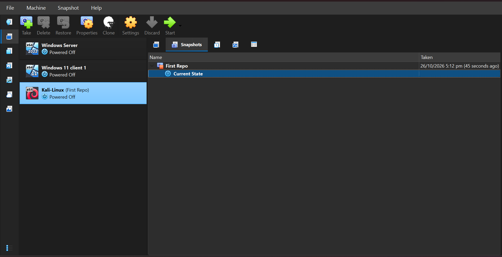

<div align="center">

# 🔐 Cybersecurity Lab Setup: VirtualBox and Kali Linux (WK1-PM1)

### Building an isolated virtual lab for penetration testing and ethical hacking practice


**WK1-PM1 · NetworkWalks Cybersecurity Training**

</div>

---

This repository documents my Week 1 Project Module for NetworkWalks. I built a small cybersecurity practice lab on my own laptop using Fedora Linux, Oracle VirtualBox, and Kali Linux.

The purpose of the lab is to provide a controlled environment for learning and practising ethical hacking. All testing in this lab is intended for systems that I own or have permission to test.

## 📑 Table of Contents

- [Project Information](#-project-information)
- [Host Machine Specifications](#-host-machine-specifications)
- [Lab Requirements and Configuration](#-lab-requirements-and-configuration)
- [Step-by-Step Setup](#-step-by-step-setup)
- [Troubleshooting](#-troubleshooting)
- [What I Learned](#-what-i-learned)
- [Security and Ethical Use](#-security-and-ethical-use)
- [Tools and Resources](#-tools-and-resources)
- [Author](#-author)

## 📋 Project Information

| Item | Details |
|------|---------|
| Program | Cybersecurity at NetworkWalks |
| Week and module | Week 01 - Project Module 01 (WK1-PM1) |
| Project | Cybersecurity and Pentesting Lab Setup |
| Author | Mulenga Chiwele |
| Batch | B083 |
| LinkedIn | [Mulenga Chiwele](https://www.linkedin.com/in/mulenga-chiwele-712a64365/) |

## 💻 Host Machine Specifications

I completed the setup on the following laptop:

| Component | Details |
|-----------|---------|
| Hardware model | Lenovo ThinkPad X1 Carbon 6th Gen (20KH) |
| Host operating system | Fedora Linux (Workstation Edition) |
| Processor | Intel Core i7-8650U @ 1.90 GHz (4 cores, 8 logical processors) |
| Memory | 16 GB |
| Storage | 256 GB SSD |

## ⚙️ Lab Requirements and Configuration

The important configuration values for this lab are:

| Item | Configuration |
|------|---------------|
| Hypervisor | Oracle VirtualBox |
| Guest / attack machine | Kali Linux |
| NAT Network | 10.0.0.0/24 |
| Kali static address | 10.0.0.2/24 |
| Gateway | 10.0.0.1 |
| DNS configured for the connection | 8.8.8.8 |
| Clipboard | Bidirectional |
| Drag and drop | Bidirectional |
| Shared folder | Host Downloads folder, auto-mounted in Kali |
| Snapshot | Clean baseline snapshot after setup and testing |

The custom NAT Network allows the virtual machines to communicate on the same private virtual network, while VirtualBox provides outbound network address translation. This is different from using ordinary NAT for each VM separately.

## 🛠️ Step-by-Step Setup

### Step 1: Install 7-Zip and extract the Kali image

I used Fedora's terminal to install the 7-Zip utilities. I then extracted the Kali Linux VirtualBox archive so that the virtual appliance could be imported into VirtualBox.

```bash
sudo dnf install 7zip 7zip-plugins
cd ~/Downloads
7z x kali-linux-*-virtualbox-amd64.7z
```
### Step 2: Create the NAT Network

After opening VirtualBox, I created a custom NAT Network with the prefix `10.0.0.0/24`. DHCP was enabled in the VirtualBox network settings.


*Figure 3: Creating the VirtualBox NAT Network with the 10.0.0.0/24 prefix.*

### Step 3: Import the extracted Kali Linux appliance

I imported the extracted Kali Linux virtual appliance into VirtualBox using the appliance import option. This added the pre-built Kali virtual machine to VirtualBox Manager so that I could configure its resources and network adapter.

> The screenshots in this repository focus on the configuration after the import rather than the import progress window.

### Step 4: Attach Kali Linux to the NAT Network

In the Kali VM's Network settings, I attached Adapter 1 to the custom NAT Network. This connects Kali to the private `10.0.0.0/24` virtual network.

*Figure 4: Attaching the Kali Linux network adapter to the custom NAT Network.*

### Step 5: Configure the VM resources

I reviewed the Kali VM settings and allocated resources suitable for my laptop: 4 GB of RAM and 2 virtual CPUs. I also checked the display settings so that the VM would run smoothly.


*Figure 5: Kali Linux virtual machine settings and resource allocation.*

### Step 6: Enable bidirectional clipboard and drag and drop

In the VirtualBox **General → Advanced** settings, I set Shared Clipboard and Drag and Drop to **Bidirectional**. This makes it easier to transfer commands and small pieces of text between Fedora and Kali while working in the lab.


*Figure 6: Shared Clipboard and Drag and Drop configured as Bidirectional.*

### Step 7: Configure the Kali static IP

Inside Kali Linux, I configured the wired connection with the following IPv4 values:

| Setting | Value |
|---------|-------|
| Address | 10.0.0.2/24 |
| Gateway | 10.0.0.1 |
| DNS configured for the connection | 8.8.8.8 |

```bash
nmcli con show
sudo nmcli con mod "Wired connection 1" ipv4.method manual \
  ipv4.addresses 10.0.0.2/24 ipv4.gateway 10.0.0.1 ipv4.dns 8.8.8.8
sudo nmcli con down "Wired connection 1"
sudo nmcli con up "Wired connection 1"
```


*Figure 7: Static IP, gateway, and DNS configured with nmcli.*

### Step 8: Configure the shared folder & Verify the shared folder inside Kali

I added my host's Downloads folder as a VirtualBox shared folder and enabled auto-mount. This allows me to move permitted lab files between the Fedora host and the Kali VM without repeatedly configuring a new transfer method.

After starting Kali, I checked that the shared folder was mounted and that a file could be viewed from inside the VM. This confirmed that the host-to-guest file-sharing configuration was working.


*Figure 8-9: The shared folder and its file visible inside Kali Linux.*

### Step 10: Verify networking and security tools

I used the Kali terminal to check the address, routing table, gateway connectivity, internet access, DNS resolution, and the availability of Nmap:

```bash
ip addr show
ip route show
ping -c 4 10.0.0.1
ping -c 4 google.com
nmap --version
nslookup networkwalks.com
```

| Test | Result |
|------|--------|
| IP address | 10.0.0.2/24 assigned to eth0 |
| Gateway reachable | Replies received from 10.0.0.1 |
| Internet and DNS | `ping -c 4 google.com` succeeded, confirming outbound connectivity and name resolution |
| Nmap installed | Version **[add your version]** |
| DNS lookup | `networkwalks.com` resolved to **[add your result]** via resolver **[add your resolver]** |

```text
[Paste your own nmap --version and nslookup output here]
```

*Figure 10: Kali terminal output showing the IP, route, and connectivity checks.*

### Step 11: Take a clean snapshot

Once the configuration and checks were complete, I created a clean VirtualBox snapshot named **Clean Baseline**. This gives me a known-good restore point before I begin future security exercises or make changes to the VM.


*Figure 11: Clean Baseline snapshot of the Kali Linux VM.*

## 🧰 Troubleshooting

### Kali initially had an internet connection problem

After configuring the static address, the Kali VM did not have internet access even though the local virtual network was configured. I restarted the NetworkManager connection, then applied the DAD (duplicate address detection) timeout setting so the problem would not return after a restart.

```bash
# Restart the connection as a temporary fix
sudo nmcli connection down "Wired connection 1"
sudo nmcli connection up "Wired connection 1"

# Apply the setting so the problem does not return after restarting
sudo nmcli connection modify "Wired connection 1" ipv4.dad-timeout 0
sudo nmcli connection down "Wired connection 1"
sudo nmcli connection up "Wired connection 1"
```

After restarting the connection, I was able to complete the gateway and internet checks. This was the most useful troubleshooting part of the lab because it made me work through the network configuration instead of only following the setup steps.

### Running host commands inside the guest

I ran `dnf` inside Kali and got `command not found`. Fedora uses `dnf` and Kali (Debian-based) uses `apt`. The terminal prompt shows which machine I am on, so I check it before running package commands.

| Machine | Package manager | Example |
|---------|-----------------|---------|
| Fedora (host) | `dnf` | `sudo dnf install 7zip` |
| Kali (guest) | `apt` | `sudo apt install 7zip` |

## 🎓 What I Learned

This project gave me my first complete walkthrough of building a small virtual cybersecurity lab. My main takeaways were:

### NAT and NAT Network are not the same
At first, I thought NAT and NAT Network were two names for the same setting. I learned that a normal NAT connection gives a VM outbound access independently, while a NAT Network creates a shared virtual subnet. That shared subnet is more useful when several practice machines need to communicate with one another.

### Virtual network settings affect everything else
The Kali VM could not communicate correctly until the VirtualBox adapter, NAT Network, IP address, gateway, and DNS settings all matched. I learned to check those layers one at a time instead of changing several settings at once.

### Static IP configuration needs verification
I learned how to set a static IPv4 address and confirm it with `ip addr` and `ip route`. The `ping` and `nslookup` checks also showed me that having an IP address is not enough; the route and name resolution must work as well.

### Snapshots make experimentation safer
Taking a clean snapshot before starting security exercises gives me a known-good point to return to. That is especially useful in a lab where future tools or configuration changes may break the VM.

### Documentation is part of the technical work
Writing down the commands, settings, screenshots, and the connectivity problem made the setup easier to review. It also gives me a reproducible record that I can use when I build another lab machine.

## ⚖️ Security and Ethical Use

> ⚠️ This laboratory is for education and authorised ethical hacking practice only.

I will use the tools and techniques in this repository only against systems that I own or have explicit permission to test. Unauthorised access to computer systems is illegal.

## 🔗 Tools and Resources

- [7-Zip official downloads](https://www.7-zip.org/download.html)
- [Oracle VirtualBox downloads](https://www.virtualbox.org/wiki/Downloads)
- [Kali Linux official downloads](https://www.kali.org/get-kali/)
- [Fedora Linux](https://fedoraproject.org/)
- [NetworkWalks Academy](https://networkwalks.com)

## 👤 Author

**Mulenga Chiwele**
Cybersecurity student, Batch B083
[LinkedIn profile](https://www.linkedin.com/in/mulenga-chiwele-712a64365/)

<div align="center">

*Created as part of NetworkWalks Cybersecurity Training, WK1-PM1.*

</div>
